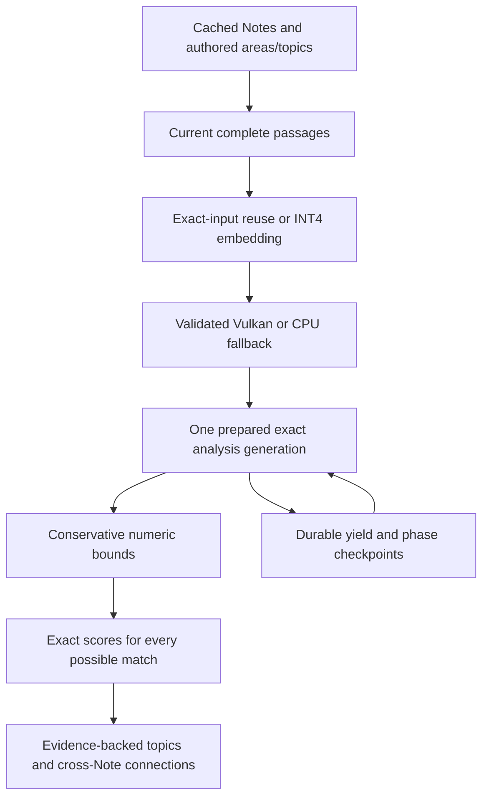

# Discovery architecture review — 19 October 2026

The user chose INT4 and delegated decisions about device backends and lower-cost
Discovery using existing authored areas/topics. No private source text is included.

## Why millions of comparisons for 51 Notes?

The number shown was completed work, not an estimate of future comparisons. The
engine increments a cumulative counter for cluster distances and candidate-to-
passage membership scores. One Note is not one vector. Read-only inspection before
migration found 50 indexed S25 Notes with 4,218 passages across 750 sections; the
user reported 51 Notes. The preservation baseline contains 50 Note files plus an
internal journal, which an initial report incorrectly counted as 51 Notes.
Another observed Pixel checkpoint had 19 indexed
Notes, 2,080 passage-direction opportunities and 7,000,000 completed comparisons.
The reported 14-million count was not directly recaptured; it is consistent with
millions of passage-level checks rather than 1,275 unordered pairs of 51 Notes.

Exact nearest-neighbor-chain average linkage scales quadratically in passage
opportunities and performs 768-dimensional float arithmetic. Membership projection
adds candidate-count times eligible-passage work. These vectors remain 768d with
INT4: quantization speeds model inference, not automatically this analysis loop.

## Defects and redundant work found

- A query/power/window pause could discard the current 250,000-check quantum.
- Completing formation immediately before a connection pause could lose the final
  formation slice at the phase boundary.
- Every slice reread the library, normalized vectors, rebuilt sums and revalidated
  a growing projection prefix, including already-trusted process-owned data.
- Progress did not clearly connect Notes to passage groups and completed work.

The fixes preserve exact outcomes and source/model invalidation. New regression
checks failed before the corresponding guards and passed after implementation.

## Implemented design

Areas/topics are acceleration hints, not hard partitions or relevance labels.
Vector-ball bounds can skip membership arithmetic only with a strict proof that
all bucket evidence is below threshold, including float rounding margin. Matching
cross-area/topic and unlabelled evidence is retained. Broad incoherent buckets may
provide no pruning; correctness takes priority over a claimed speedup.

The prepared workspace is process-owned, bounded to one generation and keyed by
source/model/policy/metadata/cache state. Disk-imported checkpoints remain fully
validated. Memory release interrupts current work and drops optional caches.
Exact-input memoization uses complete identity and input equality, never just area,
topic, title or passage ID. Reused vectors attach to current source evidence. Reset,
source changes and release clear it; stale in-flight completions cannot refill it.

Automatic backend selection compares first-input Vulkan output with CPU at cosine
at least .9995, validates every later output, disables a failed backend for the
process and retries CPU. No fixed-shape QNN research graph is enabled in production.

## Deployment and boundaries

S25 deployment used the real explicit model-download API: 206,696,682 verified
bytes and Vulkan selected. All three public INT4 host references had cosine above
.9999999999993. Immediately after initial deployment all baseline file hashes
matched. A later check found no missing baseline files and unchanged settings;
one of 50 Note files and the internal cache journal changed. Without a full
pre-deployment content snapshot their change cannot be attributed, so continued
byte identity of that Note is not claimed.
Pixel disconnected before deployment; its earlier Gemma GPU failure requires CPU
fallback. The new fallback behavior has fake-session regression coverage; physical
Pixel deployment remains unavailable until it reconnects.

This work does not establish independent human relevance acceptance, sustained
battery/heat/peak memory, universal API/ABI support or human TalkBack speech.
Exact hierarchy can still require many checks; the aim is less repeated and
provably unnecessary arithmetic, not hiding work by dropping evidence.

## Measured result

On the frozen 500-document WOS corpus (861 passage opportunities), bounded and
exhaustive INT4 runs produced identical seed groups and published evidence,
memberships, labels, ordering and scores, ignoring generated topic IDs. Both
visited 915,377 formation pairs. Conservative suffix bounds avoided 487,748,864
of the exhaustive 703,009,536 vector components (69.38%). This is arithmetic
saved, not a claim of 69% lower end-to-end time or fewer model invocations.
Single host runs took 0.303 versus 0.418 seconds for formation; repeated physical
device timing remains open.

The public corpus has no useful authored area/topic grouping and skipped no
projection pairs through metadata bounds. A separate 12-Note, four-subject
contract fixture skipped 36 of 48 projection dots with identical evidence.
Real-library metadata speedup depends on vector coherence and is not promised.

Fine-category pair diagnostics on the 300-document test split were identical:
352 correct of 928 predicted, 1,391 gold; precision .3793, recall .2531, F1 .3036.
Publisher categories are an imperfect relevance proxy, not human acceptance.
See the [compact evidence record](../tools/semantic-discovery/discovery-efficiency-2026-10-19.json).
