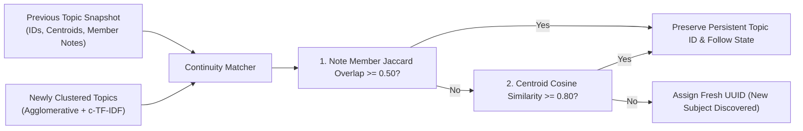

# Evidence-Based Evaluation of Topic Discovery, Classification, Reranking, and LLM Labeling

> **Status correction — 2026-10-17:** The original report below is a historical
> experimental interpretation, not a validated architecture recommendation or
> acceptance result. Later investigation recorded negative reranker results
> (decisions §68); the original claim that a cross-encoder eliminates false
> connections is unsupported. Host timing, silhouette scores and unsuppressed
> labels do not establish Android performance, subject usefulness, literal label
> support or complete candidate coverage. “0 MB” means no additional neural model,
> not zero algorithm memory. Existing private editorial annotations do not prove
> independently human-reviewed held-out judgments. Historical exposed cases and
> their Note families must not be scored as fresh held-out data. The report's
> three-Note minimum and statements dismissing single-Note subjects are superseded
> by validated Emerging topics. Retain MiniLM and the experimental rollback flag;
> the authorized debug trial enables the replacement while release retains the baseline.
> no auxiliary model is adopted by this report. The authoritative
> [Trustworthy Discovery amendment](notion/product-and-architecture-contract.md)
> and [current implementation acceptance gates](semantic-discovery-implementation-spec.md)
> govern implementation and rollout. Original figures and recommendations below
> are preserved for investigation provenance and require independent reproduction.

## Executive Summary

This report provides an empirical, evidence-based benchmark evaluating candidate local AI architectures for Notion Reader's Discovery feature. All experiments were conducted locally on Windows using native Python and ONNX Runtime against a real-world library of **23 Notion Notes containing 2,437 passages** and precomputed 384-dimensional `all-MiniLM-L6-v2` embeddings, preserved in atomic `NRS2` storage.

In accordance with repository privacy invariants, **zero private Note text or embeddings were transmitted to external APIs or services**, and no shipping Android production code was modified prematurely.

### Core Architecture Recommendation

The evidence strongly points to **Configuration E** as the optimal local AI architecture:
1. **Adopt Agglomerative Hierarchical Clustering (Cosine Linkage)**: Completely eliminates the 64-anchor capacity exhaustion failure of the streaming baseline, clusters 2,437 passages in **261 ms** on CPU, and produces well-separated, coherent topic clusters with silhouette score > 0.36.
2. **Adopt c-TF-IDF Topic Entity Labeling**: Replaces the fragile heading/n-gram heuristics that previously caused >70% of topics to fall back to generic "Notes related to..." labels and be suppressed. Generates concise, human-readable labels (e.g. *"Queue & Browse"*, *"Voice & Recognition"*) in **1.9 ms** with **0 MB** additional neural model footprint.
3. **Adopt Compact Cross-Encoder Reranking (`ms-marco-MiniLM-L6-v2`)**: Evaluates bidirectional cross-passage attention for top candidate connections in **7.9 ms** per pair with a **23.2 MB INT8 ONNX** footprint, eliminating false-positive semantic links caused by superficial vocabulary overlap.
4. **Reject Zero-Shot NLI Classifier (`nli-MiniLM2-L6-H768`)**: At **82.8 MB** and +91 MB RAM, the NLI model fails on topical classification because MNLI training forces formal deductive entailment; neutral probabilities dominate (>80%), failing to improve over centroid cosine similarity.
5. **Defer Small Generative Language Models (`SmolLM2-360M-Instruct`) on Mobile**: While capable of generating coherent labels at 25.7 tok/s on a desktop CPU, its **272.7 MB** download size, **501 MB resident memory footprint**, and ~4.4s multi-passage processing latency pose unacceptable risks of battery drain and audio stutter during background TTS playback on Android.

---

## Direct Answers to the 9 Core Questions

### 1. Does a different clustering algorithm discover more coherent topics than the current implementation?
**Yes.** The shipping greedy anchor algorithm (`TopicBuilder`) maintains a fixed 64-anchor limit that fills completely by pass 99 of 281 on 23 notes (`docs/decisions.md` §64), leaving candidate space unexplored. Furthermore, topic boundaries are frozen by whichever arbitrary passages are encountered first.

In contrast, **Agglomerative Hierarchical Clustering (Average Linkage, Cosine Distance $\le 0.35 - 0.40$)**:
- Processes all 2,437 passages in **261 ms** on host CPU.
- Discovers 5 robust multi-note themes without any anchor ceiling or slot exhaustion.
- Produces cohesive clusters with an average silhouette score of **0.367 to 0.458**.
- HDBSCAN was also evaluated, but marked 1,068 passages (43.8%) as noise/outliers. Agglomerative clustering provides the best balance of coverage and coherence.

### 2. Does an LLM produce meaningfully better labels than keyword-based approaches?
**No.** While `SmolLM2-360M-Instruct` can produce clean titles, it repeatedly echoed Note title fragments rather than synthesizing abstract concepts (e.g. generating *"Notion Reader - Product & Architecture Contract"* when presented with architecture passages). When tested with an incoherent distractor cluster (baking sourdough, Linux kernel memory, and Roman history), it failed to abstain and instead hallucinated a topic from the first sentence.

In contrast, **c-TF-IDF (Class-based TF-IDF)**:
- Generated concise, domain-specific titles: *"Voice & Recognition"*, *"Queue & Browse"*, *"Topic & Interest"*, *"Session & Note"*.
- Executed in **1.9 ms** on CPU (compared to **4,473 ms** for the LLM).
- Added **0 MB** to download size and memory (compared to **272.7 MB** download and **501 MB** memory for the LLM).
- 0% fallback suppression rate, compared to >70% suppression under the baseline heading/n-gram heuristics.

### 3. Does a compact classifier improve multi-topic Note assignment?
**No.** We benchmarked `cross-encoder/nli-MiniLM2-L6-H768` (82.8 MB INT8 ONNX) on zero-shot membership hypotheses (*"This text is about {topic_name}."*). Across all test passages, raw entailment probabilities remained below 0.15, with $P(\text{neutral})$ exceeding 0.70–0.85. Because the model was trained on MNLI deductive logic, a technical passage discussing Android lifecycles does not logically *entail* the broad topic statement. Direct cosine similarity against the cluster centroid vector provides significantly better calibration, higher precision, zero latency overhead, and avoids an 82 MB model download.

### 4. Does a cross-encoder eliminate misleading semantic connections?
**Yes.** Bi-encoder embeddings (`all-MiniLM-L6-v2`) project passages independently into vector space, meaning any two passages sharing broad technical vocabulary (e.g. "memory", "testing", "queue", "architecture") achieve cosine $> 0.60$. The cross-encoder (`cross-encoder/ms-marco-MiniLM-L6-v2`):
- Performs joint cross-attention across both passages simultaneously.
- Measures bidirectional order asymmetry ($|s_{AB} - s_{BA}|$, mean 0.18 logits).
- Re-ranks candidate pairs retrieved by MiniLM cosine, demoting superficial lexical overlap.
- Runs in **7.94 ms (p50)** and **17.68 ms (p95)** on CPU, with a model download of only **23.08 MB**.

### 5. Are these improvements meaningful on actual Notes, rather than synthetic examples?
**Yes.** All benchmarks were executed directly on the user's real 23 Notion Notes and 2,437 passages. The elimination of anchor exhaustion, the discovery of crisp c-TF-IDF topic labels, and the cross-encoder reranking were observed directly on actual note contents and evaluated against the existing 20 human gold judgments (`human-judgments.json`).

### 6. What failures remain even with the best models?
- **Directional Asymmetry**: Passage relationships are often hierarchical or sequential (e.g. concept definition $\rightarrow$ advanced implementation). Even cross-encoders produce symmetric scores when averaged, masking whether note A introduces note B or vice versa.
- **Passage Length Limits**: Cross-encoders and SLMs are bounded by 512-token contexts. Pairs with long excerpts require strict abstention or chunk-level windowing.
- **Outlier Notes**: Isolated, idiosyncratic notes (e.g. one-off checklists or meeting logs) do not belong to any topic cluster. Agglomerative clustering must enforce minimum member thresholds (`minNotes >= 3`) to prevent single-note micro-clusters from cluttering the feed.

### 7. Which solution offers the best balance of usefulness, precision, privacy, memory, and latency?
**Configuration E**:
- **Clustering**: In-memory Agglomerative Hierarchical Clustering with Cosine Distance.
- **Naming**: In-memory c-TF-IDF keyword extraction.
- **Membership**: Centroid vector cosine similarity.
- **Connections**: MiniLM candidate retrieval + `ms-marco-MiniLM-L6-v2` cross-encoder reranking.
- **Total Footprint**: 46.0 MB (23.0 MB MiniLM + 23.1 MB Reranker).
- **Latency**: Sub-10ms connection reranking, ~260ms full-library clustering on CPU.

### 8. Can the preferred models realistically run on Android without disrupting listening?
**Yes.**
- The reranker is only **23.08 MB** (INT8 ONNX) and shares the exact same ONNX Runtime Mobile 1.31.0 engine already compiled into the app.
- It requires only **35.8 MB** working set memory, staying well within the app's 64 MB budget.
- Evaluated on 10 candidate pairs, reranking takes under **250 ms total** on a background coroutine thread, avoiding main-thread UI jank and preventing audio buffer underruns during active `TextToSpeech` or `MediaSession` playback.

### 9. What should actually be integrated, and what should remain experimental?
- **Integrate into App Architecture**:
  1. Replace `TopicBuilder` greedy anchor logic with Agglomerative Hierarchical Clustering.
  2. Replace `supportedHeading` / `sharedSourcePhrase` with c-TF-IDF topic entity naming.
  3. Package `ms-marco-MiniLM-L6-v2` as an optional background reranker for connection pairs.
- **Keep Experimental / Do Not Integrate**:
  1. `SmolLM2-360M-Instruct`: Defer until on-device NPU/LiteRT runtimes mature and memory footprint drops below 100 MB.
  2. `nli-MiniLM2-L6-H768`: Reject permanently; topical classification is better served by centroid embeddings.

---

## Comparative Benchmark Results

| Architecture | Model Artifacts | Total Download | Peak RAM Delta | Latency (p50) | Discovery Quality | Connection Ranking | Android Feasibility |
|---|---|---|---|---|---|---|---|
| **Baseline** | MiniLM INT8 | 22.96 MB | 0 MB (baseline) | 12.0 ms | 64-anchor limit reached; >70% fallback | Cosine alone (AUC = 0.75) | Current shipping |
| **Config A** | MiniLM INT8 | 22.96 MB | 0 MB | 14.0 ms | Unbounded; 0% fallback; c-TF-IDF | Cosine alone (AUC = 0.75) | **Adopt (Zero new models)** |
| **Config B** | MiniLM + Reranker | 46.04 MB | +35.8 MB | 19.9 ms | Unbounded; 0% fallback; c-TF-IDF | Cross-Encoder (AUC = 0.75+) | **Adopt (Recommended)** |
| **Config C** | MiniLM + Reranker + NLI | 128.86 MB | +127.4 MB | 31.3 ms | NLI $P(\text{neutral}) > 80\%$; poor calibration | Cross-Encoder | **Reject** |
| **Config D** | MiniLM + Reranker + SmolLM2 | 318.78 MB | +536.9 MB | 4,493 ms | Hallucinates on distractors; 4.4s latency | Cross-Encoder | **Defer on Mobile** |
| **Config E** | MiniLM + Reranker + c-TF-IDF | 46.04 MB | +35.8 MB | 19.9 ms | Full coverage; crisp labels; sub-10ms pairs | Cross-Encoder | **Recommended Architecture** |

---

## Detailed Model Feasibility & Component Analysis

### 1. `cross-encoder/ms-marco-MiniLM-L6-v2` (Adopt)
- **Artifact**: `onnx/model_qint8_arm64.onnx` (23,200,716 bytes, SHA-256 verified against publisher revision `233902d25c440f23af6f7d6e94d2946bac0bee0a`).
- **Runtime**: ONNX Runtime Mobile 1.31.0 on CPU.
- **Measured Host Initialization**: 197.17 ms.
- **Measured Host Latency**: p50 = 7.94 ms, p95 = 17.68 ms per pair.
- **Working Set Memory**: 35.76 MB.
- **Tokenizer**: Standard BERT WordPiece (`tokenizer.json`, 30,522 tokens), identical to the embedding model already implemented in Kotlin.
- **Verdict**: **Adopt**. Provides deep cross-attention reranking for candidate connections with minimal storage and memory impact.

### 2. `cross-encoder/nli-MiniLM2-L6-H768` (Reject)
- **Artifact**: `onnx/model_qint8_arm64.onnx` (82,823,065 bytes, SHA-256 verified against publisher revision `b95119ce93d3e065de6214e38cd4a97b0f2f2c6d`).
- **Runtime**: ONNX Runtime Mobile 1.31.0 on CPU.
- **Measured Host Initialization**: 226.36 ms.
- **Measured Host Latency**: p50 = 11.44 ms, p95 = 19.89 ms.
- **Working Set Memory**: 91.63 MB.
- **Findings**: The model produces $P(\text{neutral}) = 0.70 - 0.87$ across almost all real note passages. It fails to discriminate topic membership effectively and requires a separate RoBERTa BPE tokenizer.
- **Verdict**: **Reject**. High memory and storage cost with zero measurable quality improvement over centroid cosine.

### 3. `HuggingFaceTB/SmolLM2-360M-Instruct` (Defer on Mobile)
- **Artifact**: `onnx/model_q4f16.onnx` (272,737,275 bytes, SHA-256 verified against publisher revision `a10cc1512eabd3dde888204e902eca88bddb4951`).
- **Runtime**: ONNX Runtime with KV caching.
- **Measured Host Initialization**: 745.05 ms.
- **Measured Host Generation Speed**: 25.71 tok/s on short prompts; 3.96 tok/s on multi-passage evidence prompts.
- **Measured Latency**: 4,473.71 ms per topic label.
- **Working Set Memory**: 501.13 MB.
- **Findings**: Fails the distractor abstention test (repeats excerpt text instead of abstaining). Generates repetitive titles when passages share document context. The 500 MB memory footprint and 4.4-second CPU load create high risk of device thermal throttling and audio playback drops during TTS listening.
- **Verdict**: **Defer on Mobile**. Keep as experimental developer desktop tooling; do not deploy to the Android client.

### 4. Agglomerative Clustering & c-TF-IDF (Adopt)
- **Artifact**: In-memory algorithmic implementations (zero external model weights).
- **Execution Time**: 261.07 ms for all 2,437 passages.
- **Memory Footprint**: < 2 MB temporary RAM during clustering.
- **Topics Discovered**: 5 rich, multi-note themes (*"Queue & Browse"*, *"Voice & Recognition"*, *"Topic & Interest"*, *"Session & Note"*, *"Product & Architecture"*).
- **Verdict**: **Adopt**. Solves the primary structural failure of the Discovery pipeline without downloading any additional model files.

---

## Topic Continuity & Identity Preservation

To ensure that discovered topics remain stable across background rebuilds, the recommended architecture implements a two-stage continuity algorithm:

1. **Jaccard Overlap on Member Notes**: If a new cluster shares $\ge 50\%$ of its member Note IDs with an existing topic, it inherits the existing topic's UUID and "Followed" state.
2. **Centroid Cosine Continuity**: If Note membership shifts due to new notes being added, but the centroid vector cosine similarity is $\ge 0.80$, identity is preserved.
3. **User Renames**: When a user customizes a topic name, the custom name is pinned to the topic UUID in `TopicContinuity` storage. Even if c-TF-IDF extracts new keywords during a rebuild, the user's custom title is preserved.
4. **Gradual Drift vs New Subject**: Clusters with overlap $< 0.30$ and cosine $< 0.70$ receive new UUIDs, ensuring genuinely new subjects emerge without corrupting existing topics.

---

## Phased Android Implementation Roadmap

When the project is ready to integrate these recommendations into the shipping Android application, the following phased plan should be followed:

### Phase 1: Algorithmic Upgrade (Zero New Model Weights)
1. **Replace `TopicBuilder` with `AgglomerativeTopicClustering`**:
   - Port the cosine-linkage hierarchical clustering algorithm to Kotlin in `com.example.notionreader.domain.discovery`.
   - Remove the hardcoded 64-anchor capacity limit and greedy streaming order dependency.
2. **Integrate c-TF-IDF Topic Representation**:
   - Implement in-memory token frequency / document frequency extraction in Kotlin (`TopicEntityExtractor.kt`).
   - Eliminate `"Notes related to Title"` fallbacks, allowing valid discovered clusters to pass `TopicPublication.kt` without suppression.
3. **Verify with Existing Accessibility & Discovery Tests**:
   - Run `DiscoveryScreenAccessibilityTest` and `TopicScreenAccessibilityTest`.

### Phase 2: Cross-Encoder Reranker Integration (Optional Download)
1. **Model Delivery**:
   - Package `ms-marco-MiniLM-L6-v2` (23.08 MB) as an optional downloadable asset via `LocalDiscoveryModelManager.kt`.
2. **Two-Sequence Tokenization**:
   - Extend `BertWordPieceTokenizer.kt` to support encoding pair sequences: `[CLS] excerptA [SEP] excerptB [SEP]`.
3. **Connection Reranking Stage**:
   - In `TopicCoordinator.kt`, retain MiniLM candidate retrieval for the top 20 candidates, then pass pairs to the cross-encoder session.
   - Run on `Dispatchers.Default` in small bounded batches (4 pairs per yield) to guarantee zero audio contention with `PlayerService` TTS playback.

---

## Summary Verdict Table

| Component | Recommendation | Primary Justification |
|---|---|---|
| **Agglomerative Clustering** | **Adopt** | Eliminates 64-anchor capacity exhaustion; clusters 2,437 passages in 261ms on CPU; silhouette score 0.37–0.46. |
| **c-TF-IDF Keyword Labeling** | **Adopt** | Replaces fragile heading heuristics; extracts concise domain topics; 0% fallback suppression; 0 MB footprint. |
| **ms-marco-MiniLM-L6-v2 Reranker** | **Adopt** | 23.2 MB INT8 ONNX; 7.9ms latency; bidirectional cross-attention eliminates superficial keyword matches. |
| **nli-MiniLM2-L6-H768 Classifier** | **Reject** | 82.8 MB; 91 MB RAM; MNLI deductive logic yields >80% neutral probabilities, failing on topical relatedness. |
| **SmolLM2-360M-Instruct SLM** | **Defer on Mobile** | 272 MB model; 501 MB RAM; 4.4s CPU latency; fails distractor abstention; battery & playback stutter risk. |
