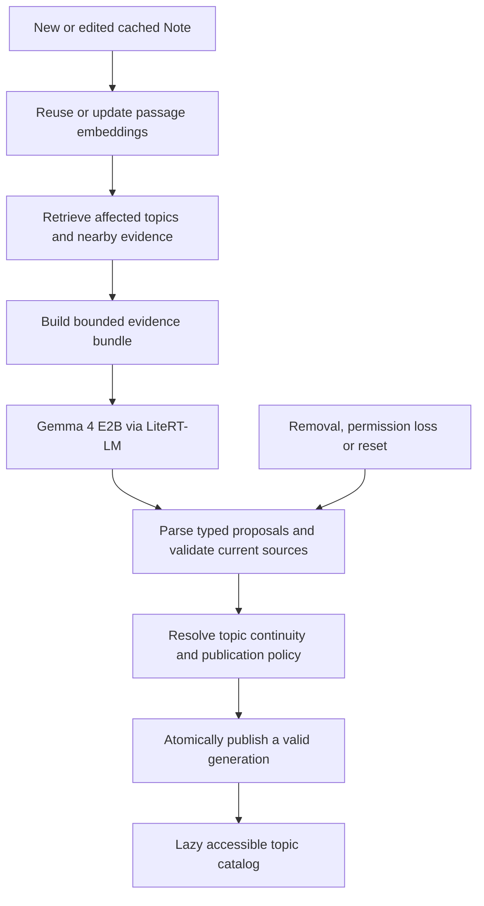

# LLM-assisted Discovery v2 Implementation Plan

**Superseded for implementation on 2026-10-26:** use [the sole grouping-plus-labeling plan](2026-10-26-sole-grouping-llm-labeling.md). Full LLM formation/retrieval reconciliation is historical proposed scope, not a second pipeline to implement.

> **For agentic workers:** Use superpowers:executing-plans to implement this plan task by task. Use delegation only when authorized. Steps use checkboxes for tracking. Do not execute production tasks before the specification gates below pass.

**Goal:** Generate useful, specific, evidence-grounded topics and labels from cached Notes using local Gemma 4 E2B through LiteRT-LM, while preserving reliable listening, search, privacy and topic continuity.

**Architecture:** Existing EmbeddingGemma embeddings retrieve bounded neighborhoods of current source passages. Gemma 4 E2B proposes concepts, labels and passage memberships from those bundles. Typed validation, source withdrawal, continuity and atomic publication remain application responsibilities. One process-owned bulk coordinator schedules embedding and generation work; screens never own inference.

**Tech stack:** Kotlin, Compose, existing Gradle module and WorkManager, existing EmbeddingGemma pipeline, Gemma 4 E2B via LiteRT-LM, JUnit 4 and handwritten fakes. Pin actual published artifact/runtime identities after verification; this plan asserts no unverified model availability, performance or backend support.

**Spec:** Governing contracts listed in `docs/README.md`; existing non-governing `docs/discovery-v2/` proposal. This document proposes amendments to that proposal, not permission to override current governing semantics.

**Status:** Detailed proposed implementation plan, 2026-10-25. No implementation or release acceptance is claimed. User selected Gemma 4 E2B and LiteRT-LM. Local-only processing preserves the existing privacy boundary. The candidate interfaces and file names below are proposed engineering choices, to be reconciled with approved contracts in Phase 0.

## Global constraints

- Generated files under `docs/notion/` are never hand-edited. Amend owning Notion sources, export and review dependent specifications first.
- Preserve domain/application/data/platform/UI layer rules. Runtime implementations belong in data beside existing embedding infrastructure; composition root wires implementations to application-owned ports.
- One production Discovery pipeline and one serialized process-owned bulk execution gate. A frozen baseline may run in an offline evaluation harness, never as a competing production worker.
- No cloud requests, silent model downloads, whole-workspace fetching, model conversion or export. Verify published prebuilt artifacts and licensing before acquisition.
- Preserve existing power, pause, storage, source eligibility, search priority, queues, TTS and accessibility contracts. No activity profiling is added.
- Per-record semantic/topic envelopes remain at most 64 MiB and headers at most 8 MiB unless explicitly amended. Use bounded streaming persistence; no whole-corpus prompt or JSON materialization.
- Existing Android acceptance includes at least 10,000 passages across more than 2,000 uneven sections, at most 120 seconds active topic processing, cancellation within one second, durable resume and warm-search p95 below two seconds. The 2026-10-26 user-approved governing amendment sets a provisional 256 MiB added Java/native memory gate for generation, preserving 128 MiB for embedding, with separate device-pressure and Android 17 termination acceptance. These are application limits, not Google-certified thresholds; feasibility must measure them, not assume compliance.
- Native cancellation and model unloading are measured capabilities. If the proposed runtime cannot satisfy a binding requirement, stop and report the conflict rather than simulate success or quietly relax the gate.

## Design choices and alternatives

1. **Recommended: retrieval plus LLM concept formation and labeling.** Embeddings bound evidence retrieval; the LLM can group, separate and name concepts. Preserves retrieval reuse while addressing poor groupings as well as poor labels.
2. **LLM renames existing clusters.** Useful controlled evaluation baseline and smaller experiment, but cannot repair incorrect membership. Not the target architecture.
3. **Whole-library generation.** Excluded: context, memory, incremental updates and source revocation become difficult to bound.

The six-signal deterministic score in the original v2 proposal becomes an evaluation/diagnostic hypothesis. It is not a prerequisite implementation and not a probability of topic correctness. Deterministic validation proves structural/source validity; semantic grounding still requires measured quality evaluation. Neither a successful JSON parse nor a model's confidence establishes truth.

## Target data flow

## Review focus

1. Source removed during native generation: old callbacks cannot republish it (Phases 3, 5, 7).
2. Plausible but unsupported labels: citations alone cannot establish semantic support (Phases 1, 4, 8).
3. Rare concepts omitted by top-k retrieval: measure recall and revisit unmatched evidence (Phases 1, 6).
4. Model switching exhausts the S25 heap/native memory: serialize engines, measure peaks and unload safely (Phases 2, 3, 8).
5. Label changes or splits lose followed topics: identity follows surviving evidence, aliases survive independently (Phases 5, 7).

## Phase 0 — reconcile specifications and freeze the baseline

**Deliverable:** Approved semantic direction and an explicit requirement disposition, before production behavior changes.

**Files:** Amend authoritative Notion Product, Integration and UI pages as needed; regenerate their mirrors. Revise `docs/discovery-v2/{README,requirements,architecture,evidence-scoring,incremental-processing,state-migration,evaluation-acceptance,implementation-plan,traceability}.md`; update the implementation companion after approval.

- [ ] Record a baseline commit, embedding/runtime identity, existing output on consented/public fixtures and current resource/quality results. Separate missing evidence from failing evidence.
- [ ] Replace the proposal's no-generative-model/no-generative-naming rules with the local Gemma 4 E2B/LiteRT-LM path. Permit supported paraphrased labels, rather than requiring literal phrase occurrence.
- [ ] Amend the governing sole-section-aware-formation requirement deliberately. Preserve a single replacement production pipeline, not an engine selector.
- [ ] Map R01–R49 to retain, revise or defer, with reasons. Specifically revise R10/R11 deterministic scoring obligations and R21 extractive naming; remove no-LLM prohibitions. Keep evidence, multi-topic membership, Emerging topics, privacy and accessibility requirements.
- [ ] Specify membership support, provisional/abstain outcomes, split/merge continuity, user alias handling, source-backed relationships and truthful incomplete coverage. Model-generated hierarchy is out of this implementation unless separately approved; existing hierarchy evidence rules remain.
- [ ] Define optional model acquisition/deletion and degraded behavior. Missing generative model preserves valid cached topics and semantic search but reports generation unavailable; it does not silently start another formation engine.
- [ ] Export mirrors using `pwsh -File tools/export-notion-doc.ps1 -All`; inspect diffs for exporter loss and cross-spec contradictions.

**Exit gate:** Semantic conflicts resolved in owning sources; requirement matrix reviewed; no generated mirror patched manually. If unresolved, continue only an explicitly bounded public-input experiment.

**Focused commit:** “Define local generative Discovery contracts and migration rules”.

## Phase 1 — build the evaluation set before choosing prompts

**Deliverable:** Reproducible inputs and human-reviewed topic/membership judgments, with a held-out partition.

**Create:** `tools/semantic-discovery/generative/{README.md,cases.json,evaluate.py,test_evaluate.py}` and `docs/discovery-v2/generative-evaluation.md`. Cases are purpose-built/public or explicitly consented, not the real API capture fixture.

- [ ] Cover identical headings with unrelated bodies, one concept under different words, overlapping concepts, valid single-Note concepts, broad versus specific concepts, sparse Notes, contradiction, Unicode/multiple languages, duplicate templates and source deletions.
- [ ] Include malicious source instructions asking the model to ignore the task, invent citations or reveal unrelated text. Treat Note content solely as quoted evidence.
- [ ] Store expected concepts, acceptable alternative labels, supported passage memberships and uncertainty. Human reviewers judge semantic usefulness; string equality is insufficient.
- [ ] Split by Note family/template/near-duplicate group before tuning. Freeze held-out cases and rubric. Propose numerical quality thresholds in the evaluation document and obtain their acceptance before viewing held-out results; retain stronger governing targets.
- [ ] Implement evaluator self-tests: fabricated citation, omitted valid topic, unsupported label and wrong membership must each worsen the appropriate metric. Do not count unrated examples as correct.
- [ ] Compare current formation, current formation plus LLM labeling, and retrieval plus LLM formation on identical sources and embeddings. Record model/prompt/settings identities and raw public outputs.

**Exit gate:** Evaluator can detect intended errors; gold provenance is explicit; no tuning on the held-out partition.

**Focused commit:** “Add grounded topic generation fixtures and evaluation checks”.

## Phase 2 — verify Gemma 4 E2B through LiteRT-LM on the S25

**Deliverable:** A bounded public-input feasibility experiment and a go/no-go report, not product integration.

**Create:** `tools/semantic-discovery/generative/runtime-probe` tooling appropriate to the verified Android API; `docs/discovery-v2/gemma4-e2b-runtime-report.md`. Keep temporary outputs under ignored `build/agy-tasks/` or a task-specific build directory; accepted reports/tooling are tracked.

- [ ] Consult official Android/LiteRT-LM and model publisher documentation. Resolve the exact Gemma 4 E2B prebuilt model, revision, checksum, byte size, license, tokenizer/chat template, context limits, supported ABI/API and compatible LiteRT-LM dependency. Do not substitute a similarly named embedding model.
- [ ] Verify whether the current LiteRT-LM dependency supports the artifact; any upgrade gets existing embedding/tokenizer/backend regression checks. No speculative runtime migration.
- [ ] Explicitly acquire and checksum the public model for the experiment. Run fixed public short/long evidence prompts through real native generation on S25, not a host surrogate.
- [ ] Measure cold load, warm time to first token, total generation time, tokens, peak managed/native/PSS memory, model residency, thermal behavior, output validity, stop/cancel latency and unload. Evaluate CPU and only documented available backends; report unavailable backends honestly.
- [ ] Apply the approved separate device-pressure gate: inspect ActivityManager.MemoryInfo before work, trace native allocations with Android Studio/Perfetto, record anonymous RSS plus swap separately from PSS, inspect ApplicationExitInfo for Android 17 MemoryLimiter:AnonSwap exits, and test repeated batches/long bundles/backgrounding and release of inactive engines. A 256 MiB allocation result alone is not a safety pass.
- [ ] Measure embedding → generation → embedding transitions. Default proposal: one live inference engine, close before switching; batch bounded same-role work to avoid constant reload. Validate its cost before adopting it.
- [ ] Exercise playback and interactive search during generation. Cancellation APIs and serialized calls must be proven to release the gate promptly enough; coroutine cancellation alone is not evidence native generation stopped.

**Exit gate:** Verified artifact/runtime identity and measured S25 feasibility. If unsupported, too costly or unable to meet cancellation/resource gates, report the blocking condition and alternatives for approval. Do not add a cloud fallback.

**Focused commit:** “Record Gemma 4 E2B LiteRT-LM feasibility on S25”.

## Phase 3 — typed runtime port and optional model lifecycle

**Deliverable:** Real local generation behind a testable application port, with no publication changes yet.

**Create:** `domain/discovery/TopicGeneration.kt` for immutable request/result values and `domain/discovery/TopicGenerationRuntime.kt` for the suspending runtime port; `data/discovery/{GemmaTopicGenerator,GenerativeModelManager}.kt`; corresponding JVM tests. Application owns orchestration, not the interface implemented by data. This corrects the draft port location to honor `data -> domain` and `LayerRulesTest`; data must never import application. Paths are relative to `app/src/main/java/com/example/notionreader/` and matching test package roots.

**Interfaces:** `TopicGenerationRuntime.generate(request: GenerationRequest): GenerationResult`; `GenerationRequest` contains a bounded evidence bundle, generation identity and limits. `GenerationResult` distinguishes Completed, Cancelled, Unavailable and Failed. Generation identity includes artifact/tokenizer/template/prompt/schema/policy versions and effective backend provenance. Concrete LiteRT APIs are selected from Phase 2 evidence.

- [ ] Write failing tests for missing model, checksum failure, cancellation, malformed native output, backend failure and close-before-switch. Fakes model destructive close/reset behavior.
- [ ] Implement explicit atomic acquisition and separate byte accounting for the generative pack. Preserve unrelated model files and settings. Initialization never silently downloads or deletes an incompatible pack.
- [ ] Wire through `ReaderApplication`/`ReaderHost`, existing `DiscoveryWorkCoordinator`, `DiscoveryRuntime` and model management composition. Keep runtime classes out of UI/domain.
- [ ] Serialize native embedding/generation operations through the existing shared gate. Foreground search takes priority at a measured safe boundary; playback suspends bulk work under the existing policy.
- [ ] Test deletion/reset while generation is running: invalidate work, cancel/close safely and reject late results by epoch. Do not retry rejected accelerators indefinitely.
- [ ] Run relevant JVM tests and `LayerRulesTest`; preserve existing embedding output/backend tests if runtime dependencies changed.

**Exit gate:** Public-input device generation works through the actual port; failure/cancellation paths are explicit; one worker and bounded engine residency are proven.

**Focused commit:** “Add process-owned local topic generation runtime”.

## Phase 4 — grounded concept proposal in shadow mode

**Deliverable:** Candidate topics and labels with explicit source memberships, evaluated without replacing visible topics.

**Create:** `domain/discovery/{TopicEvidenceBundle,TopicProposal,TopicProposalValidator}.kt`, `application/TopicGenerationPrompt.kt`, their tests, and a tracked versioned prompt template beside the prompt builder if a separate resource improves reviewability.

**Interfaces:** `TopicEvidenceBundle` contains opaque passage IDs, current revision identity and body evidence; `TopicProposal` contains a proposed label, concept description and supporting passage IDs. `TopicProposalValidator.validate(proposals, bundle, currentSources)` returns accepted structural proposals plus rejection reasons. Model output never chooses durable IDs or supplies executable commands.

- [ ] Define a closed, versioned JSON schema. Bound input tokens using the actual tokenizer/template, reserve output/context space and cap proposal count/output bytes per request. Select exact limits from Phase 2 measurements and freeze them in a versioned policy before device integration.
- [ ] Build prompts from body evidence with minimal source context. Distinguish data from instructions. Require evidence IDs, abstention on insufficient evidence and supported concise paraphrases; do not request hidden chain of thought.
- [ ] Write failing tests for unknown IDs, empty support, stale revisions, duplicated IDs, invalid Unicode/JSON, huge output, generic labels and prompt-injection cases. Structural validation must never claim to prove semantic entailment.
- [ ] Generate concepts, not just labels: permit different passages from a Note to support different concepts; preserve one-Note Emerging candidates and ambiguous/unmatched evidence.
- [ ] Parse bounded output; enforce schema/source validity deterministically. Allow at most one bounded format-repair attempt for format errors; unsupported semantics abstain rather than enter a repair loop. Persist no unvalidated publication.
- [ ] Run Phase 1 comparisons and human review. Explicitly measure unsupported-label rate, concept precision/recall, membership accuracy, abstention and over-merging/splitting. Model self-confidence is diagnostic only.

**Exit gate:** Reviewed evidence supports the chosen prompt/formation approach; shadow results remain separate and bounded. No claim that citation existence establishes grounding.

**Focused commit:** “Generate evidence-grounded topic proposals in shadow mode”.

## Phase 5 — publication, continuity and migration

**Deliverable:** A validated candidate generation that can safely replace a prior generation after later rollout approval.

**Modify:** `domain/discovery/{TopicPublication,TopicEvidence,DiscoveredTopics,TopicContinuityReservations}.kt`, `application/{TopicCoordinator,DiscoveryValidity}.kt`, `data/local/{FileTopicStore,StoredTopicGraph}.kt`; matching tests. Create `domain/discovery/TopicProposalContinuity.kt` if needed to keep responsibilities small.

- [ ] Define publication policy using approved Phase 0 semantics and Phase 4 calibration. Explicitly separate structural acceptance, semantic evidence policy and human release evaluation.
- [ ] Write failing-first tests for label change preserving genuine identity, unrelated topic reusing a label, split/merge ambiguities, user aliases/follows, partial generation and revision withdrawal during publication.
- [ ] Map continuity using surviving source evidence and explicit conflict rules, never label equality alone. Preserve interests independently when no safe successor exists.
- [ ] Version engine/generation/schema/prompt identities separately from embeddings. Reuse compatible embeddings when only the generation prompt changes; invalidate incompatible candidates/checkpoints.
- [ ] Atomically stage bounded topic records and commit a complete consistent generation. Validate source/reset epoch immediately before commit; retain previous eligible output on storage/I/O failure and report incomplete work.
- [ ] Test interrupted writes, oversized records, corruption, insufficient capacity and rollback. Preserve the streaming persistence regression and ordinary-heap device test; no duplicated passage bodies/vectors in every topic record.
- [ ] Migration preserves Notes, interests, queues, listening and settings; does not launch the old formation engine or resurrect revoked sources.

**Exit gate:** Failure injection proves no mixed generations, unsafe identity transfer or stale-source publication.

**Focused commit:** “Publish generative topics with evidence-safe continuity”.

## Phase 6 — incremental matching and bounded reconciliation

**Deliverable:** Changes update affected topics without routinely regenerating the whole corpus.

**Create:** `domain/discovery/{TopicCandidateRetriever,TopicCandidatePool,TopicGenerationWorkKey}.kt` and `application/IncrementalTopicGeneration.kt`; adapt `application/{DiscoveryIndexing,DiscoveryRetrieval,TopicCoordinator}.kt` and corresponding tests.

- [ ] Define `TopicGenerationWorkKey` from sorted evidence content/revision fingerprints, embedding identity, generator identity, prompt/schema/policy and candidate-state version. Same key reuses a successful compatible result; timeouts/errors are not cached as completed work.
- [ ] Implement an exact small-corpus retrieval oracle first; add bounded production retrieval only with Recall@k measurement. Adaptive expansion and resumable reconciliation recover rare/unmatched concepts; no silent corpus admission cap.
- [ ] Changed passages query current valid topic evidence and nearby older eligible passages. Revalidate affected memberships and include old support for potential splits; unchanged Notes do not trigger fresh embeddings.
- [ ] Persist unmatched/provisional work and fairness cursors so new edits cannot starve old evidence. Coalesce events; incomplete coverage remains visibly incomplete.
- [ ] Write failing tests for unrelated edit causing no generation, same input reusing output, prompt change requiring regeneration, retrieval missing a rare concept, old evidence joining a new concept and edit storms not starving pending work.
- [ ] Measure model calls, tokens, reloads and active time on initial build versus single-Note edit; distinguish inference savings from retrieval recall loss.

**Exit gate:** Measured incremental savings with agreed recall; no false complete state, unbounded candidate pool or repeated identical generation.

**Focused commit:** “Update generated topics incrementally with durable reconciliation”.

## Phase 7 — background recovery and accessible presentation

**Deliverable:** End-to-end debug integration under the existing coordinator and lazy topic screens.

**Modify:** `DiscoveryWorker.kt`, `application/{DiscoveryWorkCoordinator,DiscoveryWorkPolicy,DiscoveryState}.kt`, `ui/{DiscoveryStatusNotice,DiscoveryTopicsScreen,TopicDetailsScreen}.kt`, `ui/settings/DiscoverySettingsScreen.kt`; targeted unit and accessibility tests.

- [ ] Persist resumable work only at valid boundaries; process death discards partial native output and resumes uncommitted bundles without double publication. Reboot, explicit Pause and reset remain distinct.
- [ ] Withdraw source evidence immediately across visible/pinned views, proposals and pending callbacks even while the worker waits for power. Recheck on restore and before commit.
- [ ] Explain embedding preparation, generating topics, unavailable model, waiting, paused and incomplete resource coverage with accessible non-spamming status. Do not invent a remaining-time estimate before measurement supports one.
- [ ] Topic details open persisted supporting passages without generation. Preserve lazy catalog composition and offscreen focus restoration; generation updates do not steal focus or reorder inspected views without existing Refresh semantics.
- [ ] Test process death/restart, search preemption, playback, source deletion, native timeout, low-storage and model removal through the real worker/runtime path. Target affected classes through the repository wrapper.

**Exit gate:** Durable recovery and source withdrawal on device; accessible controls and stable inspection; no playback/queue mutation.

**Focused commit:** “Integrate resumable local topic generation and accessible status”.

## Phase 8 — acceptance, staged adoption and rollback

**Deliverable:** An evidence-backed decision to enable the replacement pipeline, or a recorded failure/blocker.

- [ ] Freeze candidate code, corpus partitions, artifact/runtime/tokenizer, prompt/schema, retrieval and publication policy. Evaluate held-out quality without retuning; report denominators, uncertainty and examples of errors.
- [ ] Benchmark representative S25 workloads and a supported slower device, including the governing passage/section scale. Record cold/warm latency, p95 search, peak Java/native/PSS, thermal behavior, storage, cancellation, model swaps and playback effects. Repeated identical synthetic vectors cannot establish semantic/resource acceptance.
- [ ] Re-run race-sensitive device scenarios sufficiently to report observed pass ratios. Human TalkBack speech/listening gates remain explicitly human, separate from semantics tests.
- [ ] Enable only the authorized debug trial first. Production activation replaces the formation pipeline at an atomic generation boundary; there is no permanent second engine or model selector.
- [ ] On regression, stop new generative publication and retain only source-valid compatible saved topics; continue reading/search. A code rollback restores baseline behavior only through an explicit migration-compatible release, not a hidden parallel worker.
- [ ] Update README implementation boundaries, implementation companion, requirement traceability and a new numbered decisions round with measured results and still-open gates.

**Exit gate:** All applicable governing acceptance criteria pass or receive explicit source-of-truth amendments before adoption. Model availability and successful integration alone do not establish useful Discovery.

**Focused commit:** “Validate and adopt grounded local generative Discovery”.

## Verification protocol for every implementation task

1. Write a property-focused regression with JUnit 4/handwritten fakes; run it against the missing guard and verify the intended failure. Restore/implement the fix and confirm the same test passes.
2. Run `.\gradlew.bat :app:testDebugUnitTest`; inspect counts/results, not only exit code. Run `.\gradlew.bat :app:assembleDebug` for production/build changes.
3. For instrumentation changes run `.\gradlew.bat :app:compileDebugAndroidTestKotlin` explicitly. Run affected classes using `pwsh -NoProfile -File tools/run-accessibility-tests.ps1 -Device <verified-serial> -Class <affected-class>`. Use the verification skill for final project order.
4. For device claims verify connected serial, foreground/keyguard and actual installed artifact. Inspect `adb -s <serial> logcat` for attributable failures; absence of a stack trace is insufficient evidence against heap pressure.
5. Review diff and layer rules; append durable investigation/verification decisions when warranted. Commit only reviewed task changes with prose subjects; preserve unrelated work. No automatic push.

## Sequencing and stop conditions

**Dependency order:** 0 → 1 → 2 → 3 → 4 → 5 → 6 → 7 → 8. Public-input evaluation preparation may overlap documentation review, but shared Gradle/device/native resources are serialized. No delegated edit overlap.

**First useful milestone:** Phase 2 report plus Phase 4 public-fixture comparison. This determines whether Gemma 4 E2B improves topic formation enough to justify full migration. Do not build a complete deterministic v2 scorer first.

**Open until measured:** exact artifact and LiteRT-LM API compatibility, quantization/backend, safe context/output limits, native cancellation, model swap strategy, device latency/memory and calibrated quality thresholds. Each has a named phase gate above; executors must not fill these gaps with guessed constants or claim they were user-approved.

This plan authorizes no cloud path, new activity ranking, model-generated hierarchy, conversational assistant, automatic queue changes or full production implementation by itself.
